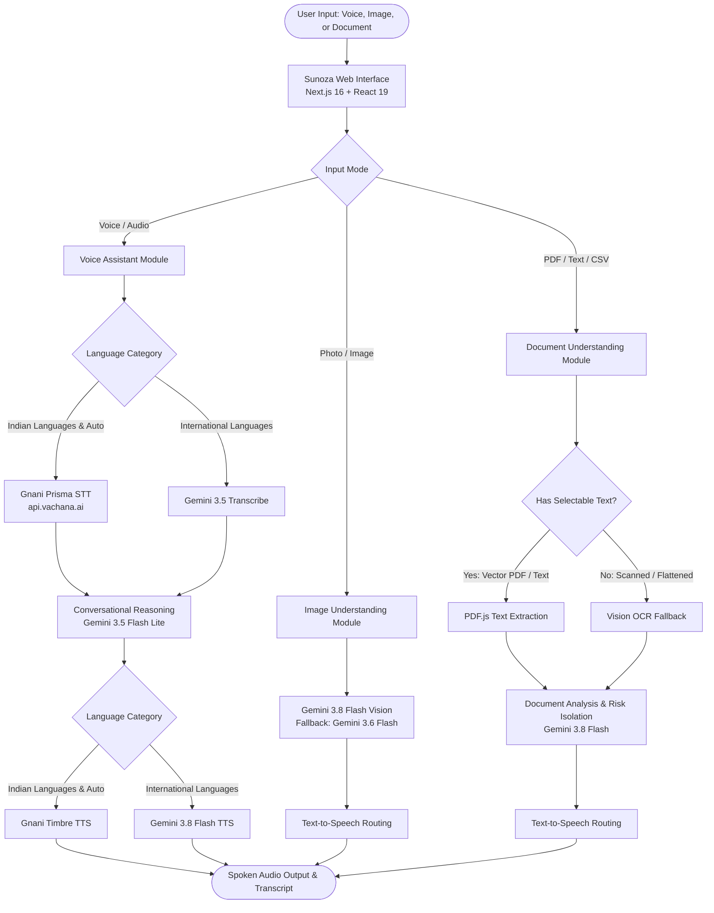

# Sunoza — Multilingual Accessibility Assistant

> **"Technology that understands you."**<br />
> An open-source, speech-first, multimodal accessibility companion empowering elderly individuals, visually impaired users, and regional language speakers across 13 languages through natural voice interaction, visual understanding, and document explanation.

---

## 1. Project Introduction

**Sunoza** is an accessibility-first assistant built upon a simple human truth: **technology should understand people, not force people to understand technology.**

Modern digital interfaces overwhelmingly assume high digital literacy, standard English fluency, sharp visual acuity, and keyboard dexterity. For millions of citizens—particularly senior citizens, rural populations, low-literacy individuals, and native regional language speakers—this creates an invisible barrier preventing equal participation in daily digital life.

Sunoza eliminates this barrier by providing a unified, tactile, voice-driven interface that lets users speak naturally, upload physical pictures, or submit dense paperwork, receiving instant conversational and spoken explanations in their mother tongue.

---

## 2. Problem Statement

Every day, millions of people encounter friction with critical everyday tasks:

- **Elderly Citizens**: Struggle with miniaturized touchscreens, complex multi-step navigation, and small sans-serif typography, preferring natural spoken conversations.
- **Visually Impaired Users**: Cannot inspect expiration dates on medicine boxes, check utility meter readouts, read physical street signage, or verify printed receipts without assistance.
- **Users with Limited Digital Literacy**: Overwhelmed by jargon-heavy SaaS dashboards, nested menu structures, and fragmented utilities.
- **Regional Language Speakers**: Find that standard voice assistants perform poorly on Indian dialects, accents, and code-mixed speech (e.g., Hinglish, Tenglish).
- **Citizens Facing Complex Documents**: Stranded by impenetrable legal agreements, bank loan statements, medical discharge summaries, and bureaucratic government circulars.

---

## 3. Main Features

### Voice Assistant
- **One-Tap Voice Interaction**: High-contrast, 96px microphone button with visual state feedback (`idle`, `listening`, `processing`, `speaking`).
- **Live Soundwave Motifs**: Dynamic CSS waveform animations communicating audio capture and response generation without relying solely on sound cues.
- **Conversational Intelligence**: Fast, polite natural-language dialogue powered by server-side Gemini models tuned for clarity and empathetic brevity.
- **Spoken Audio Responses**: High-fidelity text-to-speech engine generating natural audio output with playback, scrubber, and replay controls.
- **Audio File Upload**: Supports pre-recorded audio memos (`.wav`, `.mp3`, `.m4a`, `.ogg`, `.flac`) up to 15 MB.

### Image Understanding
- **Multimodal Visual Analysis**: Instant interpretation of photographs, bills, medicine bottles, diagrams, and physical signage (`JPEG`, `PNG`, `WEBP` up to 8 MB).
- **Targeted Questioning**: Suggested prompt chips or custom user queries (e.g., *"Read the expiry date and dosage instructions"*).
- **Spoken Explanations**: Converts visual comprehension directly into plain-language voice output in the selected language.

### Document Understanding
- **Broad File Format Support**: Ingests `.pdf`, `.txt`, `.md`, and `.csv` files up to 10 MB (up to 30 pages for PDFs).
- **Hybrid Extraction & OCR**: Uses PDF.js for fast client-side text extraction; automatically falls back to vision-based OCR for scanned or image-based pages.
- **Critical Information Extraction**: Specifically isolates deadlines, payment amounts, interest rates, penalty clauses, and warning notices.
- **Spoken Audio Readout**: Full speech synthesis allows users to listen to long documents rather than straining to read dense text.

### Progressive Web App (PWA) & Mobile-First Interface
- **Mobile-First Experience**: Designed primarily for smartphones, featuring a persistent fixed bottom navigation with three primary destinations: **Talk**, **Images**, and **Documents**.
- **Touch & Safe-Area Protection**: Layout and bottom spacing dynamically adjust for iPhone home indicators and Android navigation bars (`env(safe-area-inset-bottom)`), guaranteeing inputs and audio controls are never obscured.
- **Native Camera & Gallery Selection**: Quick-action mobile buttons for instant camera capture (`capture="environment"`) or photo library / screenshot selection.
- **Installable Standalone Experience**: Add to home screen on Android, iOS, Windows, and macOS with standalone window mode and seamless splash branding (`#33446A` / `#F3EFE6`).
- **Offline Shell & Low-Connectivity Fallback**: Built-in Service Worker precaches the core application shell, brand assets, and an accessible offline fallback page (`offline.html`).
- **App Shortcuts**: Direct home screen quick actions to jump straight into Voice Assistant (`/?tab=voice`), Image Understanding (`/?tab=image`), or Document AI (`/?tab=document`).

---

## 4. Language Support & Speech Provider Routing

Sunoza supports **13 configured languages** alongside an intelligent **Auto-detect** mode. Speech processing is dynamically routed to specialized engines optimized for regional dialects versus international phonetics:

| Language | Locale | STT Provider | TTS Provider | Reasoning Engine | Routing Category |
|---|---|---|---|---|---|
| **Auto-detect** | `auto` | Gnani Prisma v3.0 | Gnani Timbre v2.5 | Gemini | Indian (Indic Auto) |
| **English (India)** | `en-IN` | Gnani Prisma v3.0 | Gnani Timbre v2.5 | Gemini | Indian |
| **Hindi** | `hi-IN` | Gnani Prisma v3.0 | Gnani Timbre v2.5 | Gemini | Indian |
| **Telugu** | `te-IN` | Gnani Prisma v3.0 | Gnani Timbre v2.5 | Gemini | Indian |
| **Tamil** | `ta-IN` | Gnani Prisma v3.0 | Gnani Timbre v2.5 | Gemini | Indian |
| **Kannada** | `kn-IN` | Gnani Prisma v3.0 | Gnani Timbre v2.5 | Gemini | Indian |
| **Malayalam** | `ml-IN` | Gnani Prisma v3.0 | Gnani Timbre v2.5 | Gemini | Indian |
| **Bengali** | `bn-IN` | Gnani Prisma v3.0 | Gnani Timbre v2.5 | Gemini | Indian |
| **Marathi** | `mr-IN` | Gnani Prisma v3.0 | Gnani Timbre v2.5 | Gemini | Indian |
| **Gujarati** | `gu-IN` | Gnani Prisma v3.0 | Gnani Timbre v2.5 | Gemini | Indian |
| **Punjabi** | `pa-IN` | Gnani Prisma v3.0 | Gnani Timbre v2.5 | Gemini | Indian |
| **Spanish** | `es-ES` | Gemini 3.5 Transcribe | Gemini 3.8 Flash TTS | Gemini | International |
| **French** | `fr-FR` | Gemini 3.5 Transcribe | Gemini 3.8 Flash TTS | Gemini | International |
| **Japanese** | `ja-JP` | Gemini 3.5 Transcribe | Gemini 3.8 Flash TTS | Gemini | International |

> **Note on Verification**: Primary languages (Hindi, Telugu, English) have undergone extensive end-to-end voice and audio pipeline testing. Extended regional and international languages are fully configured and routed in code; real-world accuracy may vary depending on local accent and acoustic conditions.

---

## 5. Technology Stack

- **Frontend & App Framework**: [Next.js 16 (App Router)](https://nextjs.org/) with React 19 and Turbopack.
- **Language**: TypeScript 5 (Strict type checking, zero `any` leaks).
- **Styling**: [Tailwind CSS v4](https://tailwindcss.com/) with custom editorial tokens and keyframe animations.
- **Speech-to-Text (STT)**:
  - Indian Languages: [Gnani.ai Prisma STT v3.0](https://www.gnani.ai/) (`api.vachana.ai`).
  - International Languages: [Google Gemini Transcribe](https://ai.google.dev/) (`gemini-3.5-transcribe`).
- **Text-to-Speech (TTS)**:
  - Indian Languages: [Gnani.ai Timbre TTS v2.5](https://www.gnani.ai/).
  - International Languages: [Google Gemini Flash TTS](https://ai.google.dev/) (`gemini-3.8-flash-tts`).
- **Reasoning & Vision Models**:
  - Conversational Chat: `gemini-3.5-flash-lite`.
  - Image Understanding: `gemini-3.8-flash` (with automated fallback to `gemini-3.6-flash`).
  - Document Analysis: `gemini-3.8-flash` (with automated fallback to `gemini-3.6-flash`).
- **Document Processing**: `pdfjs-dist` (legacy server build for Node.js App Router).
- **PWA & Offline**: Web App Manifest (`app/manifest.ts`), custom Service Worker (`public/sw.js`), and Cache API.
- **Package Manager**: `pnpm` v11.
- **Hosting & Deployment**: [Vercel Serverless Platform](https://vercel.com/).

---

## 6. Architecture



---

## 7. Project Structure

```
sunoza/
├── app/
│   ├── api/
│   │   ├── chat/             # Conversational text interaction route
│   │   ├── document/         # Document parsing, OCR fallback, and explanation
│   │   ├── speech-to-text/   # Provider-routed speech recognition
│   │   ├── text-to-speech/   # Provider-routed audio synthesis
│   │   └── understand/       # Multimodal image analysis route
│   ├── globals.css           # Tailwind CSS 4 configuration & design tokens
│   ├── layout.tsx            # Root layout, Google Fonts (Newsreader, Manrope, Noto)
│   ├── page.tsx              # Main editorial application page & multimodal views
│   └── icon.svg              # Accessible brand soundwave icon
├── lib/
│   ├── gemini.ts             # Google Gen AI client, retry engine, and error parser
│   ├── languages.ts          # 13 language metadata definitions and routing map
│   ├── speech-providers.ts   # Gnani and Gemini STT/TTS routing logic
│   └── translations.ts       # Multilingual UI localization strings
├── public/                   # Static icons and assets
├── .env.example              # Placeholder environment variable template
├── next.config.ts            # Next.js configuration (Turbopack, serverless body limits)
├── package.json              # Dependencies and project scripts
├── pnpm-lock.yaml            # Reproducible dependency lockfile
└── tsconfig.json             # TypeScript compiler configuration
```

### Key API Routes

- **`/api/chat`**: Handles conversational dialogue turns. Uses `gemini-3.5-flash-lite` with empathetic system instructions tailored for accessibility.
- **`/api/speech-to-text`**: Ingests multipart audio forms (`.wav`, `.mp3`, etc.), routes to Gnani Prisma (Indian languages) or Gemini Transcribe (International), and returns transcribed text.
- **`/api/text-to-speech`**: Synthesizes written responses into audio buffers via Gnani Timbre or Gemini Flash TTS, returning playable `audio/wav` streams.
- **`/api/understand`**: Accepts uploaded images with user prompts; analyzes content with `gemini-3.8-flash` with automatic fallback to `gemini-3.6-flash`.
- **`/api/document`**: Ingests documents, executes PDF.js text extraction with vision OCR fallback, and synthesizes summaries highlighting financial amounts, deadlines, and cautions.

---

## 8. Installation & Local Development

### Prerequisites
- **Node.js**: `v20.x` or later (tested on Node v24).
- **pnpm**: Version 9 or 11 (`corepack enable pnpm` or `npm install -g pnpm`).

### 1. Clone the Repository
```bash
git clone https://github.com/farhan0haris/sunoza.git
cd sunoza/sunoza
```
*(Note: If cloning the root workspace, navigate into the inner `sunoza/` directory containing `package.json`)*.

### 2. Install Dependencies
```bash
pnpm install
```

### 3. Configure Environment Variables
Copy `.env.example` to create your local environment file:
```bash
cp .env.example .env.local
```

Open `.env.local` and add your server-side API keys:
```env
# Google Gemini API Key
GEMINI_API_KEY=your_gemini_api_key_here

# Gnani.ai API Key (for Prisma STT & Timbre TTS)
GNANI_API_KEY=your_gnani_api_key_here
```

### 4. Run the Development Server
```bash
pnpm dev
```
Open [http://localhost:3000](http://localhost:3000) in your browser.

### 5. Production Build & Validation
```bash
# Type check TypeScript without emitting files
npx tsc --noEmit

# Compile production build
pnpm build

# Start production server
pnpm start
```

---

## 9. Environment Variables

All API keys are accessed exclusively inside serverless API routes on the server side:

| Variable | Required | Description | Scope |
|---|---|---|---|
| `GEMINI_API_KEY` | **Yes** | Google Gemini API key used for chat, vision, document reasoning, and international STT/TTS. | Server-only (`process.env.GEMINI_API_KEY`) |
| `GNANI_API_KEY` | **Yes** | Gnani.ai API key used for Indic speech-to-text (Prisma) and text-to-speech (Timbre). | Server-only (`process.env.GNANI_API_KEY`) |

> **Security Guarantee**: Neither key is prefixed with `NEXT_PUBLIC_`. No credentials, internal API keys, or raw provider tokens are bundled into client-side JavaScript or sent to the browser.

---

## 10. Accessibility Implementation

Sunoza incorporates intentional accessibility practices throughout its visual, tactile, and typographic system:

- **High-Contrast Palette**:
  - Background: Warm ivory (`#F3EFE6`).
  - Core Text & Actions: Deep indigo (`#33446A`).
  - Warm Accents: Marigold (`#D99B37`) and Terracotta (`#B86F58`).
  - Muted Text: Deep sage (`#485E4B`) maintaining a **6.7:1 contrast ratio**, exceeding the 4.5:1 standard.
- **Generous Touch Targets**: All interactive elements, buttons, and switches maintain touch targets $\ge 44 \times 44$ px (microphone button is 96 px).
- **Clear Typographic Hierarchy**: Editorial display typography (Newsreader) paired with high-legibility interface typography (Manrope) and localized Indic scripts (Noto Sans family).
- **Screen Reader Support**: ARIA live regions (`polite`) announce speech recognition results, AI thinking states, and audio readiness without disruptive alert sounds.
- **Mobile Safari Optimization**: Form controls and textareas utilize minimum 16px body sizing to prevent unwanted mobile viewport zoom shifts.
- **Reduced Motion Support**: Strictly honors `prefers-reduced-motion: reduce` by replacing animated waveforms and pulsing halos with clean high-contrast static borders.

---

## 11. Progressive Web App (PWA) Architecture & Installation

Sunoza is engineered as a mobile-first, installable Progressive Web App adhering to modern web application standards:

### Service Worker & Caching Strategy
- **App Shell Pre-caching**: Upon service worker installation (`public/sw.js`), the application shell, manifest, icons, and offline fallback (`/offline.html`) are cached locally.
- **Navigation (HTML)**: Network-first strategy ensures users receive the freshest editorial UI updates. If network connectivity drops, the service worker automatically serves `/offline.html`.
- **Static Assets**: Stale-while-revalidate strategy for CSS, JavaScript chunks, SVG icons, and Google Fonts (`Newsreader`, `Manrope`, `Noto Sans`) provides instant repeat visits.
- **API Requests**: Direct network execution ensures cloud AI models are queried live without stale responses.

### How to Install

- **Android & Desktop Chromium (Chrome / Edge / Brave)**:
  1. Open Sunoza in your mobile or desktop browser.
  2. Tap **"Install"** on the floating install banner, or select **Install Sunoza** from the browser menu / address bar icon.
  3. The app installs to your home screen or app drawer and launches in a dedicated standalone window.

- **iOS Safari (iPhone & iPad)**:
  1. Open Sunoza in Safari.
  2. Tap the **Share** button (box with an upward arrow) in the browser navigation bar.
  3. Scroll down and select **"Add to Home Screen"**.
  4. Tap **Add** in the top-right corner. Sunoza will appear on your iOS home screen as a standalone web app.

### PWA Home Screen Shortcuts
Long-pressing the installed Sunoza icon on supported devices reveals quick-action shortcuts:
- **Voice Assistant**: Jumps directly to speech interaction (`/?tab=voice`).
- **Understand Image**: Jumps directly to image upload and analysis (`/?tab=image`).
- **Understand Document**: Jumps directly to document reading (`/?tab=document`).

### Mobile Hardware Permissions & Offline Safeguards

- **Microphone Access**: Used exclusively when the user initiates voice recording. The browser requests microphone permission upon first interaction; modern operating systems require a secure context (`https://` or `localhost`).
- **Camera & Photo Library Access**: Prompted on demand when tapping **"Take Photo"** (native camera capture) or **"Choose Photo"** (gallery/file selector).
- **Conservative Offline Security**: Cloud AI inference (Gemini and Gnani.ai) strictly requires network connectivity. The service worker precaches only the application shell, fonts, and brand assets. User audio, uploaded images, private documents, and generated transcripts are **never stored in client-side service worker caches**, ensuring complete operational privacy.

---

## 12. Security & Limitations

### Operational Safeguards
- **Server-Side Sanitation**: Raw Google Gen AI and Gnani API errors are caught and sanitized via `parseGeminiError`. Stack traces and internal endpoint URLs are never exposed to clients.
- **Exponential Backoff**: Transient 503 and 429 errors from Google Gemini trigger up to 3 automatic retries with randomized jitter before failing gracefully.

### Upload & Processing Limits
- **Image Uploads**: Maximum **8 MB** (`JPEG`, `PNG`, `WEBP`).
- **Document Uploads**: Maximum **10 MB** (`PDF`, `TXT`, `MD`, `CSV`).
- **PDF Documents**: Maximum **30 pages** per document to prevent memory exhaustion and maintain responsive latency.
- **Audio Uploads**: Maximum **15 MB** (`.wav`, `.mp3`, `.m4a`, `.ogg`, `.flac`).
- **Voice Recording**: Maximum **30 seconds** per voice turn to protect bandwidth and optimize speech recognition accuracy.

### Content Verification Notice
Sunoza is an assistive companion designed to summarize and simplify everyday information. AI-generated explanations should always be verified with official sources or qualified professionals before making legal, medical, or financial decisions.

---

## 13. Deployment on Vercel

Sunoza is architected for zero-configuration deployment on [Vercel](https://vercel.com):

1. **Connect Repository**: Import the `sunoza` repository on your Vercel Dashboard.
2. **Root Directory**: If your repository clone includes the outer wrapper folder, set the **Root Directory** to `sunoza`.
3. **Environment Variables**: In **Project Settings > Environment Variables**, add:
   - `GEMINI_API_KEY`
   - `GNANI_API_KEY`
4. **Deploy**: Click **Deploy**. Next.js API routes will deploy as Serverless Functions with Node.js runtime compatibility.

---

## 14. Project Status & Roadmap

### Current Status
- **Mobile PWA & Phase 7.6 Complete**: Full visual identity, responsive 1240px master grid, 13-language routing engine, installable PWA manifest, service worker shell caching, and multimodal document/image pipelines are implemented and verified in production builds.

### Planned Improvements (Future Work)
- [ ] Offline Web Speech API fallback when network connectivity is lost.
- [ ] Real-time streaming voice mode utilizing Gemini Live WebSockets.
- [ ] Multi-page document comparison view for contracts and invoices.
- [ ] Direct camera capture support via HTML5 MediaDevices API on supported mobile browsers.

---

## 15. Acknowledgements

- **[Gnani.ai](https://www.gnani.ai/)**: For their high-accuracy Indic language speech models (Prisma STT and Timbre TTS).
- **[Google Gemini](https://ai.google.dev/)**: For multimodal visual reasoning, document comprehension, and fast international speech APIs.
